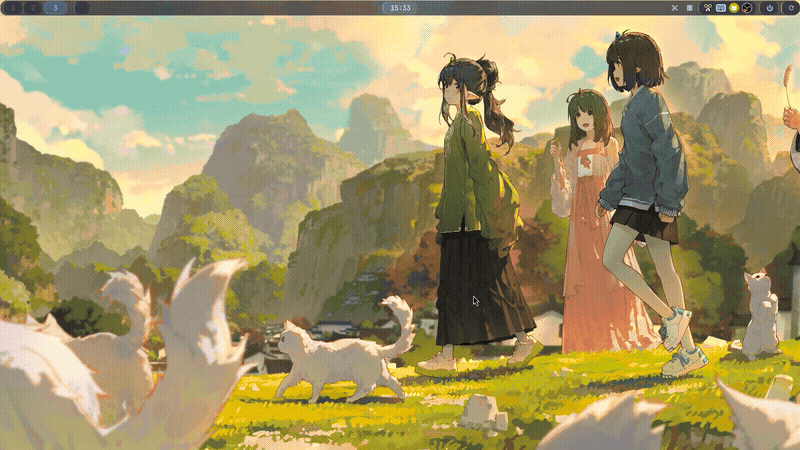
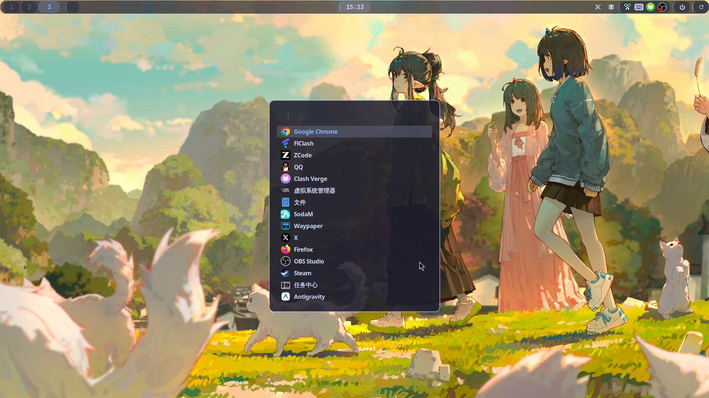
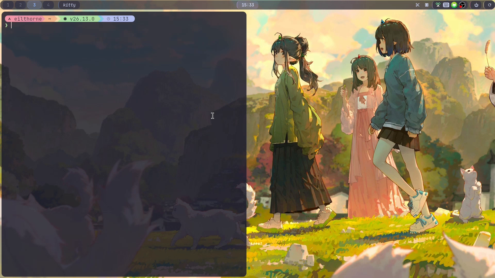
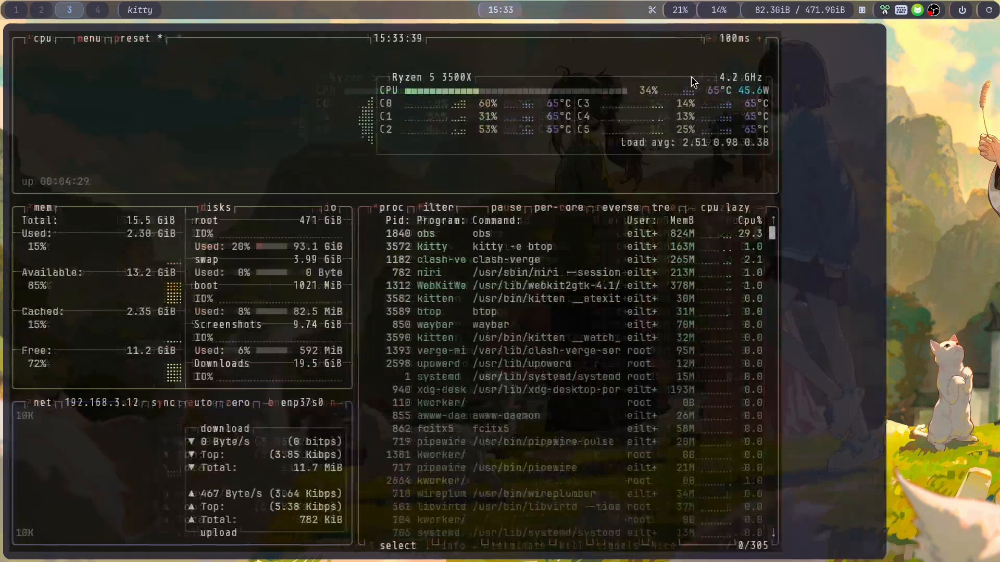
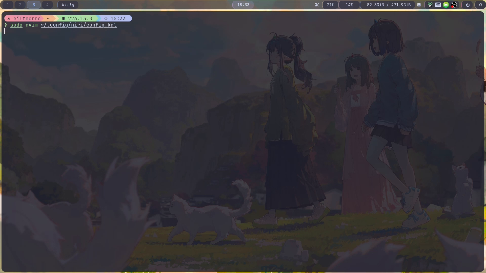
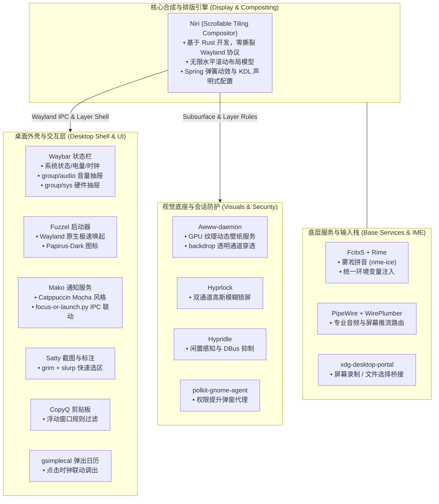

# 🌌 EilNiri

<div align="center">

**现代化、美观、极致高效的跨发行版 Niri (Wayland) 桌面环境配置套件**

[](https://github.com)
[-ff69b4.svg?style=flat-square)](https://github.com/YaLTeR/niri)
[](https://github.com/catppuccin/catppuccin)
[](https://github.com/fcitx/fcitx5)
[](LICENSE)

</div>

---

## 📖 目录

- [🌟 项目简介](#-项目简介)
- [🎬 效果展示](#-效果展示)
  - [动态预览图](#动态预览图)
  - [超清演示视频](#超清演示视频)
  - [核心场景图解](#核心场景图解)
- [🚀 使用指南](#-使用指南)
  - [支持系统与环境](#支持系统与环境)
  - [一键安装步骤](#一键安装步骤)
  - [笔记本电量补丁](#笔记本电量补丁)
  - [后台构建状态查询](#后台构建状态查询)
  - [个性化配置与定制](#个性化配置与定制)
- [⌨️ 快捷键设计](#️-快捷键设计)
  - [设计哲学与键位逻辑](#设计哲学与键位逻辑)
  - [常用快捷键速查表](#常用快捷键速查表)
- [🏛️ 架构分析](#️-架构分析)
  - [系统整体分层架构](#系统整体分层架构)
  - [核心组件选型矩阵](#核心组件选型矩阵)
  - [关键工程突破与设计细节](#关键工程突破与设计细节)
- [🛠️ 故障排查与维护 (FAQ)](#️-故障排查与维护-faq)
- [📄 开源协议与鸣谢](#-开源协议与鸣谢)

---

## 🌟 项目简介

**EilNiri** 是一套面向多主流 Linux 发行版的开箱即用 [Niri](https://github.com/YaLTeR/niri) (Wayland) 桌面环境配置与自动化部署套件。

项目基于 Niri 独特的**无限水平带状平铺（Scrollable Tiling）**窗口管理机制，整合了模块化状态栏、轻量快捷启动器、现代终端、健全统一的中文输入法方案以及完善的会话与锁屏守护，为 Linux 用户提供清晰直观、轻量流畅且开箱即用的平铺桌面生产力体验。

### ✨ 核心特性

- 🎯 **跨三大发行版家族全自动化**：提供 `arch-install.sh`、`deb-install.sh`、`RHEL-install.sh`，覆盖 Arch Linux / Manjaro、Debian / Ubuntu / Pop!_OS、Fedora / RHEL / Rocky 等主流平台。
- ⌨️ **人体工程学快捷键设计**：全面支持 `H/J/K/L` 与物理方向键导航与移动，分工明确的修饰键分级体系，双手不离键盘即可完成所有视窗编排。
- 🌏 **统一且开箱即用的中文输入体验**：三大家族全平台统一 Fcitx5 + Rime（雾凇拼音 rime-ice），原生解决 Wayland 与 Kitty 终端中文输入环境。
- 🔋 **智能模块热注入**：自带 `laptop-need-install.sh`，采用 AST 级幂等语法注入，自动补齐 Waybar 电量监视模块与低电量告警。
- 🛡️ **高稳定与会话容错**：定制防误触退出、XWayland 视频网桥透明抑制、防黑屏穿透规则及进程守护。

---

## 🎬 效果展示

### 动态预览图

以下为系统的日常流畅操作体验演示（包含终端唤起、窗口缩放预设、水平带状平铺滑动、状态栏抽屉交互与锁屏）：

<div align="center">
  
</div>

### 超清演示视频

本项目包含 1080P 60FPS 超清无损实机录屏演示视频，位于本地目录：
```text
/home/eilthorne/2-disk/演示/EilNiri演示.mp4
```

可在终端使用以下命令直接调用硬件解码器播放欣赏完整 60 帧丝滑动效：
```bash
mpv "/home/eilthorne/2-disk/演示/EilNiri演示.mp4"
# 或者使用 vlc
vlc "/home/eilthorne/2-disk/演示/EilNiri演示.mp4"
```

### 核心场景图解

| 场景 | 截图展示 | 关键功能特性 |
| :--- | :--- | :--- |
| **01. 纯净桌面与状态栏** |  | • 4K 唯美动态壁纸渲染<br>• Waybar 顶置极简状态栏<br>• 模块化系统托盘与电量/网络指标 |
| **02. Kitty 终端微透质感** |  | • `Mod+W` 极速打开终端<br>• 85% 亚克力半透明与 12px 圆角<br>• Starship 现代化三段式状态提示符 |
| **03. 监控与 Waybar 折叠抽屉** |  | • 点击状态栏触发 `group/sys` 平滑展开<br>• 实时硬件占用（CPU/内存/磁盘）<br>• 一键联动进入全功能 `btop` 面板 |
| **04. 无限水平滚动与比例预设** |  | • `Mod+R` 在 1/3、1/2、2/3 宽度间循环<br>• `Mod+F` 独占当前列最大化<br>• 视窗平滑阻尼物理弹性滚动动画 |
| **05. Hyprlock 华丽锁屏** |  | • `Super+Alt+L` 立即锁屏 / 闲置自动锁屏<br>• 双通道高斯模糊壁纸虚化<br>• 130px JetBrains Mono 大字体与 PAM 校验反馈 |

---

## 🚀 使用指南

### 支持系统与环境

| 发行版大类 | 典型支持发行版 | 安装脚本 | 机制特点 |
| :--- | :--- | :--- | :--- |
| **Arch Linux 家族** | Arch Linux, Manjaro, EndeavourOS | `arch-install.sh` | Pacman + Yay (AUR) 原生包一键到位 |
| **Debian 家族** | Debian 12+, Ubuntu 22.04+, Mint, Pop!_OS | `deb-install.sh` | APT 基础依赖 + Cargo 后台异步编译 Niri/Awww/Satty |
| **RHEL 家族** | Fedora 39+, Rocky Linux 9+, AlmaLinux, RHEL 9 | `RHEL-install.sh` | DNF + EPEL 源 + 源码编译 Fcitx5 栈与 Cargo 工具链 |

> [!IMPORTANT]
> **前置硬件与驱动建议**：
> 1. 确保内核支持 DRM/KMS，且支持 Vulkan / OpenGL ES。
> 2. NVIDIA 显卡用户需启用 DRM KMS（向内核参数添加 `nvidia-drm.modeset=1`）。
> 3. 安装前请确保网络畅通，可正常访问官方源与 GitHub。

---

### 一键安装步骤

#### 1. 克隆代码仓库
```bash
git clone https://github.com/eilthorne/EilNiri.git
cd EilNiri
```

#### 2. 执行对应系统的部署脚本

针对 **Arch Linux / Manjaro**：
```bash
# 建议普通用户通过 sudo 运行（脚本会自动识别真实登录用户）
sudo ./arch-install.sh restore
```

针对 **Debian / Ubuntu / Pop!_OS**：
```bash
sudo ./deb-install.sh restore
```

针对 **Fedora / RHEL / CentOS Stream**：
```bash
sudo ./RHEL-install.sh restore
```

> [!TIP]
> - 若需要预先检查变更而不写入系统，可追加 `--dry-run` 参数：
>   ```bash
>   sudo ./arch-install.sh restore --dry-run
>   ```
> - 若需要查阅详细帮助：`./arch-install.sh --help`。

---

### 笔记本电量补丁

如果您在笔记本电脑上使用，或者希望台式机 Waybar 也具备电量状态追踪，请在完成主安装脚本后执行：

```bash
sudo ./laptop-need-install.sh -y
# 或者直接以当前用户身份运行：
./laptop-need-install.sh -y
```

- **脚本行为**：采用原子备份与 AST 过滤机制，智能在 `~/.config/waybar/config` 的 `modules-right` 注入 `battery` 模块（10 秒静默刷新），并向 `style.css` 幂等写入状态告警样式。
- **即时生效**：优先使用 `niri msg action spawn` 触发 Waybar 平滑重启，保留全套 Wayland 环境变量不闪烁。

---

### 后台构建状态查询

在 Debian 与 RHEL 脚本运行过程中，Niri、awww、satty 等组件会在后台并行使用 Cargo 进行编译，脚本主流程结束后可随时查看构建日志与进度：

```bash
# 查看后台编译任务的当前状态与 PID
./deb-install.sh status
# 或
./RHEL-install.sh status
```

---

### 个性化配置与定制

所有桌面配置均遵循 XDG 规范，安装后已部署到 `~/.config/`：

1. **多显示器与分辨率设置**：
   在终端运行 `niri msg outputs` 查询显示器接口名，编辑 `~/.config/niri/config.kdl`：
   ```kdl
   output "DP-1" {
       mode "1920x1080@144.0"
       scale 1.0
       position x=0 y=0
       focus-at-startup
   }
   ```
2. **壁纸更换**：
   - 使用图形界面壁纸选择器：按下 `Mod+Z` 搜索启动 `waypaper`。
   - 命令行快速切换壁纸：
     ```bash
     awww img /path/to/your/wallpaper.png --transition-type wipe --transition-angle 30
     ```
3. **中文输入法切换**：
   - 默认采用 `Fcitx5 + Rime (雾凇拼音)`，快捷键为 **左 Shift** 切换中英文。
   - 配置文件位于 `~/.config/fcitx5/` 与 `~/.config/ibus/rime/`。

4. **锁屏配置（默认背景与锁屏时间）**：
   - **默认锁屏背景**：
     - 各安装脚本部署时，会自动将仓库自带的精美壁纸（`QQ图片20260713144149.jpeg`）同步部署至用户目录：`~/.local/share/backgrounds/wallpaper.jpg`。
     - 锁屏程序 `hyprlock` 默认自动加载该路径作为背景（`~/.config/hypr/hyprlock.conf` 中的 `background { path = $HOME/.local/share/backgrounds/wallpaper.jpg }`），并通过 GPU 着色器应用双通道高斯模糊（`blur_passes = 2`、`blur_size = 4`）与暗化处理，兼顾视觉美感与解锁可读性。
     - **更换锁屏背景**：直接将你喜欢的图片覆盖至 `~/.local/share/backgrounds/wallpaper.jpg`，或者修改 `~/.config/hypr/hyprlock.conf` 中的 `path` 路径。
   - **默认锁屏时间与应用抑制**：
     - 闲置状态由 `hypridle` 后台守护进程统一管理（配置文件为 `~/.config/hypr/hypridle.conf`）。
     - **默认锁屏时间为闲置 20 分钟（1200 秒）**，超时自动调起 `hyprlock`。
     - **智能防打扰**：配置已开启 `ignore_dbus_inhibit = false` 与 `ignore_systemd_inhibit = false`。当您在浏览器/MPV 全屏观看视频、或者系统正在进行包管理更新时，播放器与系统更新会发送抑制信号，系统**不会**误触发锁屏。
     - **手动即时锁屏**：按下快捷键 <kbd>Super</kbd> + <kbd>Alt</kbd> + <kbd>L</kbd> 可立即锁屏。

5. **修改锁屏时间、睡眠/休眠与关闭显示器（DPMS）**：
   编辑 `~/.config/hypr/hypridle.conf`，根据个人使用习惯按需调整：

   ```ini
   # ------------------------------
   # 通用设置
   # ------------------------------
   general {
       lock_cmd = "hyprlock"         # 锁屏执行命令
       ignore_dbus_inhibit = false   # 尊重播放器/浏览器全屏看视频的防锁屏请求
       ignore_systemd_inhibit = false
   }

   # 1. 调整自动锁屏时间（例如将 20 分钟改为 10 分钟或 5 分钟）
   listener {
       timeout = 600                 # 600 秒 = 10 分钟（原默认为 1200 秒）
       on-timeout = "hyprlock"       # 闲置超时仅执行锁屏
   }

   # 2. 自动关闭显示器 / 息屏（可选：闲置 15 分钟后息屏节能）
   listener {
       timeout = 900                 # 900 秒 = 15 分钟
       on-timeout = niri msg action power-off-monitors  # 关闭显示器
       on-resume = niri msg action power-on-monitors   # 键盘鼠标活动时重新点亮
   }

   # 3. 自动挂起 / 睡眠（可选：笔记本电脑闲置 30 分钟后系统休眠挂起）
   listener {
       timeout = 1800                # 1800 秒 = 30 分钟
       on-timeout = systemctl suspend # 触发系统挂起休眠 (Suspend to RAM)
   }
   ```

   修改完成后，保存文件并在终端运行以下命令重启 `hypridle` 即可立即生效：
   ```bash
   killall hypridle && hypridle &
   ```

---

## ⌨️ 快捷键设计

### 设计哲学与键位逻辑

EilNiri 的键盘映射方案遵循以下三大原则：

1. **流畅高效的键位映射**：全面支持 `H / J / K / L` 与标准物理方向键 `← / ↓ / ↑ / →` 保持 100% 行为等价。
2. **层次分明的修饰键分级 (Modifier Hierarchy)**：
   - `Mod` (即 `Super` / `Windows` 键)：**视窗浏览与基础聚焦**。
   - `Mod + Ctrl`：**窗口列/卡片位置移动与空间重排**。
   - `Mod + Shift`：**高优先级操作**（全屏、跨显示器调度、区域截屏、注销会话）。
   - `Super + Alt`：**系统底层控制与安全锁屏**。
3. **防误触设计**：退出环境与重载设置强制设置二次确认或长组合键，防止工作内容意外丢失。

---

### 常用快捷键速查表

#### 1. 核心应用与系统工具

| 快捷键 | 功能描述 | 关联程序 / 命令 |
| :--- | :--- | :--- |
| <kbd>Mod</kbd> + <kbd>W</kbd> | 打开现代化终端 | `kitty` (已自动预置 Fcitx 环境变量与 Zsh) |
| <kbd>Mod</kbd> + <kbd>Z</kbd> | 打开应用启动器 | `fuzzel` (支持快捷搜索与图标) |
| <kbd>Super</kbd> + <kbd>Ctrl</kbd> + <kbd>V</kbd> | 调出剪贴板历史浮窗 | `copyq toggle` |
| <kbd>Super</kbd> + <kbd>Alt</kbd> + <kbd>L</kbd> | 立即锁定屏幕 | `hyprlock` |
| <kbd>Mod</kbd> + <kbd>Shift</kbd> + <kbd>/</kbd> | 显示快捷键帮助气泡 | `show-hotkey-overlay` |
| <kbd>Mod</kbd> + <kbd>Q</kbd> | 关闭当前焦点窗口 | `close-window` |
| <kbd>Mod</kbd> + <kbd>Shift</kbd> + <kbd>E</kbd> | 退出 Niri 桌面会话 | 弹出退出确认对话框 |
| <kbd>Mod</kbd> + <kbd>Shift</kbd> + <kbd>P</kbd> | 关闭显示器电源 (省电) | 任意键盘/鼠标输入自动唤醒 |

#### 2. 窗口聚焦与水平浏览 (Focus)

| 快捷键 | 功能描述 |
| :--- | :--- |
| <kbd>Mod</kbd> + <kbd>H</kbd> 或 <kbd>Mod</kbd> + <kbd>←</kbd> | 焦点向左移动一列 |
| <kbd>Mod</kbd> + <kbd>L</kbd> 或 <kbd>Mod</kbd> + <kbd>→</kbd> | 焦点向右移动一列 |
| <kbd>Mod</kbd> + <kbd>J</kbd> 或 <kbd>Mod</kbd> + <kbd>↓</kbd> | 在当前列中向下聚焦窗口 |
| <kbd>Mod</kbd> + <kbd>K</kbd> 或 <kbd>Mod</kbd> + <kbd>↑</kbd> | 在当前列中向上聚焦窗口 |
| <kbd>Mod</kbd> + <kbd>Home</kbd> / <kbd>Mod</kbd> + <kbd>End</kbd> | 快速聚焦至带状平铺的最左端 / 最右端 |
| <kbd>Mod</kbd> + <kbd>O</kbd> | 切换多任务鸟瞰概览模式 (Overview) |

#### 3. 窗口移动与列编排 (Move & Column Management)

| 快捷键 | 功能描述 |
| :--- | :--- |
| <kbd>Mod</kbd> + <kbd>Ctrl</kbd> + <kbd>H</kbd> / <kbd>←</kbd> | 将当前列向左平移一格 |
| <kbd>Mod</kbd> + <kbd>Ctrl</kbd> + <kbd>L</kbd> / <kbd>→</kbd> | 将当前列向右平移一格 |
| <kbd>Mod</kbd> + <kbd>Ctrl</kbd> + <kbd>J</kbd> / <kbd>↓</kbd> | 在当前列中将窗口向下移动 |
| <kbd>Mod</kbd> + <kbd>Ctrl</kbd> + <kbd>K</kbd> / <kbd>↑</kbd> | 在当前列中将窗口向上移动 |
| <kbd>Mod</kbd> + <kbd>[</kbd> / <kbd>Mod</kbd> + <kbd>]</kbd> | 向左 / 向右智能并入或弹出窗口 |
| <kbd>Mod</kbd> + <kbd>,</kbd> (逗号) | 将右侧一列的窗口合并入当前列底部 |
| <kbd>Mod</kbd> + <kbd>.</kbd> (句号) | 将当前列最下方的窗口向右弹出独立成列 |

#### 4. 窗口尺寸、比例与状态调节 (Sizing & Layout)

| 快捷键 | 功能描述 | 对应逻辑 |
| :--- | :--- | :--- |
| <kbd>Mod</kbd> + <kbd>R</kbd> | 循环切换预设列宽 | 在 `33.3%` $\rightarrow$ `50%` $\rightarrow$ `66.7%` 之间切换 |
| <kbd>Mod</kbd> + <kbd>Shift</kbd> + <kbd>R</kbd> | 反向循环切换预设列宽 | 逆序切换预设列宽 |
| <kbd>Mod</kbd> + <kbd>F</kbd> | 最大化当前列 | 保留窗口边距 (Gaps) 的最大化显示 |
| <kbd>Mod</kbd> + <kbd>M</kbd> | 边缘贴齐最大化 | 铺满当前屏幕边缘 (相当于常规双击标题栏) |
| <kbd>Mod</kbd> + <kbd>Shift</kbd> + <kbd>F</kbd> | 极致全屏模式 | 隐藏状态栏与边距的全屏展现 |
| <kbd>Mod</kbd> + <kbd>C</kbd> | 居中当前列 | 快速将焦点列置于视窗正中央 |
| <kbd>Mod</kbd> + <kbd>-</kbd> / <kbd>Mod</kbd> + <kbd>=</kbd> | 精细缩放列宽 | 列宽度减少 10% / 增加 10% |
| <kbd>Mod</kbd> + <kbd>V</kbd> | 切换浮动模式 | 将当前窗口在“浮动卡片”与“平铺视窗”间切换 |
| <kbd>Mod</kbd> + <kbd>T</kbd> | 切换标签卡模式 | 将当前列窗口转化为竖向 Tabs 视图 |

#### 5. 工作区与多显示器 (Workspaces & Monitors)

| 快捷键 | 功能描述 |
| :--- | :--- |
| <kbd>Mod</kbd> + <kbd>1</kbd> ~ <kbd>9</kbd> | 快速直达第 1 到 9 号动态工作区 |
| <kbd>Mod</kbd> + <kbd>Ctrl</kbd> + <kbd>1</kbd> ~ <kbd>9</kbd> | 将当前列移至指定索引工作区 |
| <kbd>Mod</kbd> + <kbd>U</kbd> / <kbd>Mod</kbd> + <kbd>I</kbd> | 向下 / 向上切换工作区 (等同于 PageDown / PageUp) |
| <kbd>Mod</kbd> + <kbd>Shift</kbd> + <kbd>H/J/K/L</kbd> | 跨显示器移动焦点至左/下/上/右侧屏幕 |
| <kbd>Mod</kbd> + <kbd>Shift</kbd> + <kbd>Ctrl</kbd> + <kbd>H/L</kbd> | 将当前列直接推送到左/右侧目标显示器 |

#### 6. 截图、多媒体与硬件按键

| 快捷键 | 功能描述 | 调起程序 / 机制 |
| :--- | :--- | :--- |
| <kbd>Mod</kbd> + <kbd>Shift</kbd> + <kbd>S</kbd> | 区域交互式截图与标注 | `slurp + grim` 选区，直接送入 `satty` 标注编辑器 |
| <kbd>Ctrl</kbd> + <kbd>Print</kbd> | 全屏截图并保存 | 自动保存至 `~/Pictures/Screenshots/` |
| <kbd>Alt</kbd> + <kbd>Print</kbd> | 当前窗口截图并保存 | 截取活动窗口并自动命名保存 |
| <kbd>音量加 / 减 / 静音</kbd> | 调节或静音扬声器 | `wpctl` (支持锁屏状态下响应) |
| <kbd>麦克风静音键</kbd> | 快速开关麦克风录音 | `wpctl set-mute @DEFAULT_SOURCE@ toggle` |
| <kbd>媒体播放 / 暂停 / 切歌</kbd> | 操控多媒体播放器 | `playerctl` (适配所有标准 MPRIS 播放器) |
| <kbd>屏幕亮度增 / 减</kbd> | 阶梯式调节背光 | `brightnessctl set +10% / 10%-` |

---

## 🏛️ 架构分析

### 系统整体分层架构

EilNiri 构建于现代 Wayland 生态体系之上，各个组件各司其职，形成了高效、低损耗、低延迟的流水线结构：



---

### 核心组件选型矩阵

| 组件职能 | 选用工具 | 选型权衡与优势 |
| :--- | :--- | :--- |
| **Wayland 合成器** | `niri` | 无限宽带状滚动布局避免了传统平铺窗口切分过小的问题；内置弹簧物理动画，对多屏幕与分数缩放支持极佳。 |
| **状态面板** | `waybar` | 极高可定制性，通过 CSS 赋予毛玻璃亚克力质感，原生集成 MPRIS、网络、蓝牙及系统折叠抽屉。 |
| **应用启动器** | `fuzzel` | 相比 rofi-wayland 更加轻量迅捷，内存开销极低，支持亚像素圆角与 Wayland overlay 渲染。 |
| **通知中心** | `mako` | 轻量高效，通过外部脚本与 Niri IPC 深度绑定，点击通知即可瞬间跳跃至目标窗口。 |
| **锁屏与闲置守护** | `hyprlock` + `hypridle` | 具有出色的 GPU 着色器模糊效果，并精准遵循 Chromium/Firefox/MPV 的 DBus 闲置抑制规范。 |
| **壁纸渲染引擎** | `awww` | 相比传统 swww 性能更优，帧率平滑稳定，无内存泄漏风险。 |
| **中文输入法** | `fcitx5` + `rime-ice` | 当前 Linux 社区词库最健全、体验最接近 macOS 原生输入的现代中文方案。 |

---

### 关键工程突破与设计细节

#### 1. 壁纸穿透防黑屏机制 (Backdrop Rendering)
在传统平铺窗口管理器中，多显示器动态切换壁纸或开启透明终端时，极易发生“黑底遮盖”或“壁纸闪烁”问题。
EilNiri 通过对 Niri 实施底层图层规则（`layer-rule`）配合透明视口背景解决：
```kdl
layer-rule {
    match namespace="^awww-daemon$"
    place-within-backdrop true
}

layout {
    background-color "transparent"
    gaps 5
}
```
这使得 `awww-daemon` 直接位于背景合成槽位中，实现了无缝壁纸过渡与极低 GPU 负载。

#### 2. 全发行版统一输入法栈与环境注入
针对 Linux 下 Wayland 终端和各 GUI 框架对输入法模块支持的异构性，EilNiri 在启动入口（`envvars.conf` 及 `config.kdl`）严格定义了环境标准：
```kdl
environment {
    XMODIFIERS "@im=fcitx"
    GTK_IM_MODULE "fcitx"
    QT_IM_MODULE "fcitx"
    SDL_IM_MODULE "fcitx"
    GLFW_IM_MODULE "ibus"  // 解决基于 GLFW/特殊渲染管线终端的兼容性
}
```
并在启动终端快捷键时显式传递，保证 Kitty 与各大图形软件中英文输入顺畅无阻。

#### 3. 动态抽屉系统与 Niri IPC 低载交互
在 `~/.config/waybar/config` 中，EilNiri 精心设计了 **Audio 抽屉** 与 **System 抽屉**：
- 默认状态下仅展示主图标，保持状态栏呼吸感；
- 点击后平滑滑出音量控制、更新状态、蓝牙、CPU、内存及磁盘分区指标；
- 避免大量轮询脚本在后台常驻消耗 CPU，保持桌面待机功耗低于 0.5W。

#### 4. 智能窗口规则体系
在 `config.kdl` 中精细打磨了各类应用的行为匹配规则：
- **微透规则**：Kitty、QQ、微信自动应用 85% 优雅透明度与 12~24px 圆角；
- **浮动自适应**：CopyQ 剪贴板历史限制为 `600x500` 悬浮卡片；Firefox 画中画（Picture-in-Picture）自动浮动；
- **干扰抑制**：针对 KDE 跨平台屏幕捕获桥接程序（`xwaylandvideobridge`），自动将其宽高置零并透明化，彻底消除桌面多余的空白占位方块。

---

## 🛠️ 故障排查与维护 (FAQ)

### Q1: 登录进入 Niri 后屏幕出现空白或黑屏怎么办？
- **检查显示器输出配置**：由于每个人的物理接口（如 `eDP-1`、`HDMI-A-1`、`DP-1`、`DVI-D-1`）不同，请按下 `Mod+W` 打开终端，运行 `niri msg outputs`，将输出的正确接口名称写入 `~/.config/niri/config.kdl` 的 `output` 字段中。

### Q2: 在终端或某些窗口中无法使用 Fcitx5 打出中文？
- 检查 Fcitx5 守护进程是否已随桌面正常启动：`pgrep fcitx5`。
- 本套配置针对 Kitty 做了特殊的环境适配，在 `config.kdl` 中启动 Kitty 绑定了环境变量；如果从其他环境启动 Kitty，请确保继承了 `~/.config/environment.d/envvars.conf` 中的环境变量。

### Q3: 运行 `deb-install.sh` 或 `RHEL-install.sh` 提示后台正在构建？
- Debian 与 RHEL 源中不自带高版本 Niri 与 Awww，安装脚本会自动在后台使用 Cargo 工具链并发编译二进制文件。可运行 `./deb-install.sh status` 或 `./RHEL-install.sh status` 实时查看编译进度。编译完成后会自动安装至 `/usr/local/bin`。

### Q4: 笔记本屏幕休眠后如何快速唤醒？
- 移动鼠标或敲击任意键盘按键即可点亮屏幕；若处于锁屏状态，输入当前登录用户的系统密码并按回车即可快速解锁进入桌面。

---

## 📄 开源协议与鸣谢

本项目采用 [GNU General Public License v3.0 (GPL-3.0)](LICENSE) 开源协议授权。

### 💖 致谢以下优秀开源项目与社区：
- [Niri](https://github.com/YaLTeR/niri) - 极具创新精神的 Wayland 滚动平铺合成器
- [Catppuccin](https://github.com/catppuccin/catppuccin) - 温暖舒适的开源配色方案
- [Waybar](https://github.com/Alexays/Waybar) - 高度灵活的 Wayland 桌面状态栏
- [Awww](https://github.com/cynicsun/awww) - 流畅高效的 Wayland 动态壁纸守护进程
- [Rime 雾凇拼音](https://github.com/iDvel/rime-ice) - 精雕细琢的简体中文输入法词库方案
- [shorin-arch-setup](https://github.com/SHORiN-KiWATA/shorin-arch-setup) - 优秀的安装向导交互设计灵感
